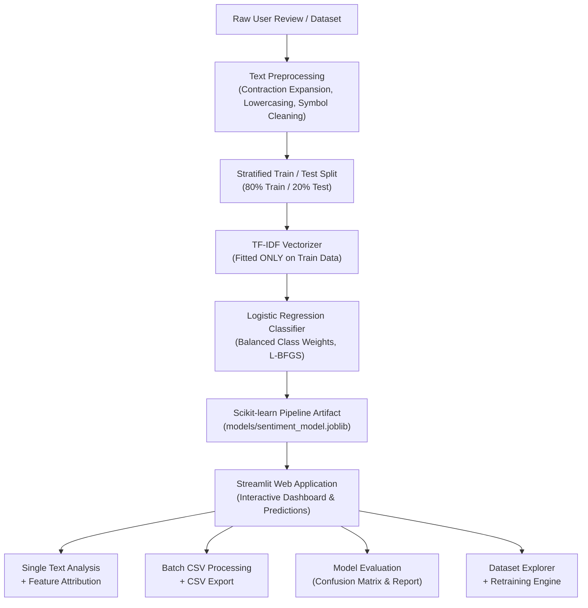

# ⚡ SentimentAI — Text Sentiment Analyzer

[](https://www.python.org/)
[](https://streamlit.io/)
[](https://scikit-learn.org/)
[](https://plotly.com/)
[](LICENSE)

An end-to-end, production-grade Natural Language Processing (NLP) and Machine Learning system that classifies customer reviews, social media posts, product feedback, and user comments into **Positive**, **Negative**, or **Neutral** sentiment.

Built from scratch with **Python**, **Scikit-learn**, **TF-IDF Vectorization**, **Logistic Regression**, and an interactive dark-navy dashboard in **Streamlit**.

---

## 🌟 Key Features

- **End-to-End NLP Pipeline:**
  - Robust text normalization (HTML removal, URL stripping, handle cleaning).
  - English contraction expansion (*"don't"* → *"do not"*, *"wasn't"* → *"was not"*) to preserve critical negation context.
  - Sublinear TF-IDF vectorization with unigrams and bigrams (`(1, 2)` n-grams).
  - Multi-class Logistic Regression with class-balanced weighting and L-BFGS optimization.
  - Zero data leakage: vectorizer fits solely on the training partition.
- **Single Text Inference & Explainability:**
  - Real-time sentiment prediction with calibrated class probabilities.
  - Interactive horizontal probability distribution bar chart.
  - **Feature Attribution:** Inspects which words or bigrams shifted the model's prediction odds.
  - Preset example reviews (Positive, Negative, Neutral, Mixed) for instant testing.
- **Batch CSV Analysis & Export:**
  - Process customer datasets containing hundreds or thousands of rows in bulk.
  - Flexible column selector mapping any CSV schema to the NLP pipeline.
  - Aggregate statistics: review counts, percentages, and sentiment distribution donut and bar charts.
  - One-click export of predictions, probabilities, and cleaned texts as a downloadable CSV.
- **Model Performance & Genuine Evaluation:**
  - True metrics computed on an unseen, stratified test split (never fabricated).
  - Interactive **Confusion Matrix** heatmap with exact counts and percentages.
  - Per-class Precision, Recall, and F1-score visualization.
  - Beginner-friendly educational guide explaining evaluation metrics.
- **Dataset Explorer & Custom Retraining:**
  - Interactive data table with keyword search and class filtering.
  - Duplicate detection and missing-value statistics.
  - Upload custom labeled datasets, validate schemas, and retrain the model on the fly without restarting the server.
- **Clean Architecture & Full Test Coverage:**
  - Modular codebase (`src/preprocessing.py`, `src/train_model.py`, `src/predict.py`, `src/evaluation.py`).
  - Automated unit test suite using `pytest`.

---

## 🏗️ Architecture & Pipeline Workflow



---

## 📂 Project Directory Structure

```text
sentiment-analysis-system/
│
├── app.py                      # Main Streamlit web application & UI
├── requirements.txt            # Python dependencies
├── README.md                   # Complete documentation & guide
├── .gitignore                  # Git ignore rules
│
├── data/
│   ├── sample_sentiment.csv    # 300 balanced training reviews (Pos, Neg, Neu)
│   └── batch_test_reviews.csv  # 20 diverse test reviews for batch demo
│
├── src/
│   ├── __init__.py             # Package marker
│   ├── preprocessing.py        # Text cleaning, contraction expansion, dataset validation
│   ├── train_model.py          # TF-IDF pipeline training, metrics evaluation, Joblib persistence
│   ├── predict.py              # Single inference, batch prediction, feature attribution
│   └── evaluation.py           # Plotly charts (confusion matrix, metrics, distributions)
│
├── models/
│   ├── .gitkeep                # Tracks directory in git
│   └── sentiment_model.joblib  # Trained model bundle (pipeline, classes, metrics)
│
├── tests/
│   ├── test_preprocessing.py   # Unit tests for text cleaning and data validation
│   └── test_prediction.py      # Unit tests for inference, probabilities, and batch processing
│
└── .streamlit/
    └── config.toml             # Custom sleek dark navy theme configuration
```

---

## ⚙️ Installation & Setup (Windows / macOS / Linux)

### Option A: Standard Python & Virtual Environment (Recommended)

1. **Clone the repository:**
   ```bash
   git clone https://github.com/your-username/sentiment-analysis-system.git
   cd sentiment-analysis-system
   ```

2. **Create and activate a virtual environment:**
   - **On Windows (PowerShell):**
     ```powershell
     python -m venv .venv
     .\.venv\Scripts\Activate.ps1
     ```
   - **On Windows (Command Prompt):**
     ```cmd
     python -m venv .venv
     .\.venv\Scripts\activate.bat
     ```
   - **On macOS / Linux:**
     ```bash
     python3 -m venv .venv
     source .venv/bin/activate
     ```

3. **Install the required dependencies:**
   ```bash
   pip install --upgrade pip
   pip install -r requirements.txt
   ```

---

### Option B: Ultra-fast setup using `uv`

If you have [`uv`](https://github.com/astral-sh/uv) installed:
```bash
uv venv --python 3.11 .venv
.\.venv\Scripts\activate
uv pip install -r requirements.txt
```

---

## 🚀 Running the Project

### 1. Train the Machine Learning Model (CLI)
You can train and evaluate the model directly from the command line:
```bash
python -m src.train_model
```
*Output preview:*
```text
Training Sentiment Analysis model with sample dataset...

Model successfully trained and saved to: models/sentiment_model.joblib
Total Samples: 299 (Train: 239, Test: 60)
Classes: ['Negative', 'Neutral', 'Positive']
Test Accuracy: 63.33%
Test F1 (Weighted): 61.20%

Classification Report:
               precision    recall  f1-score   support

    Negative       0.50      0.35      0.41        20
     Neutral       0.66      0.95      0.78        20
    Positive       0.71      0.60      0.65        20
```

### 2. Launch the Streamlit Web Application
```bash
streamlit run app.py
```
Open your browser and navigate to **`http://localhost:8501`**.

---

## 🧪 Running the Unit Tests

Run the automated test suite using `pytest`:
```bash
pytest tests/ -v
```
All 20 test cases will execute, validating text cleaning, contraction handling, label standardization, model loading, probability sum constraints, feature explanations, and batch predictions.

---

## 📖 Machine Learning Concepts Explained

### 1. What is TF-IDF (Term Frequency-Inverse Document Frequency)?
- **Term Frequency (TF):** Measures how frequently a word appears in a specific review.
- **Inverse Document Frequency (IDF):** Penalizes generic words that appear everywhere (e.g., *"the"*, *"is"*), while highlighting informative, distinct words (e.g., *"exceptional"*, *"defective"*).
- **Sublinear TF Scaling:** Replaces raw term count $f$ with $1 + \log(f)$ to prevent frequent words from dominating the feature space.
- **N-Grams (1, 2):** Considers both individual words (*"good"*, *"bad"*) and pairs of consecutive words (*"not good"*, *"highly recommend"*).

### 2. Why Logistic Regression for Text Classification?
- Highly effective, fast, and interpretable baseline for high-dimensional, sparse text vectors.
- Supports class probability estimation via the **Softmax** function.
- Resilient to overfitting when regularized ($L_2$ penalty).
- Handles class imbalances using `class_weight='balanced'`.

### 3. Understanding the Evaluation Metrics
- **Accuracy:** The percentage of unseen test reviews correctly classified.
- **Precision:** Out of all reviews predicted as Positive, how many were genuinely Positive? *(Minimizes false alarms).*
- **Recall:** Out of all actual Positive reviews, how many did the model find? *(Minimizes missed detections).*
- **F1-Score:** The harmonic mean of Precision and Recall. Essential for balanced evaluation across multiple classes.
- **Confusion Matrix:** A $3 \times 3$ grid comparing True vs. Predicted classes to reveal where model confusion occurs.

---

## 📝 Sample Inputs for Testing

| Review Text | Expected Class | Reason |
|:---|:---:|:---|
| *"The battery life is exceptional and the display quality completely blew me away. Highly recommended!"* | **Positive** | Positive terms: *exceptional, blew me away, highly recommended*. |
| *"The screen started flickering and customer service refused to issue a refund. Complete waste of money!"* | **Negative** | Negative terms: *flickering, refused, refund, waste of money*. |
| *"The package arrived on Tuesday via standard ground courier and includes a USB-C charging cord."* | **Neutral** | Objective, factual statement with no sentiment modifiers. |
| *"The camera takes good pictures in daylight, but the battery drains fast and it overheats."* | **Mixed / Nuanced** | Shows probabilities distributed across classes. |

---

## 📤 Uploading to GitHub

To push this project to your GitHub profile:

1. **Initialize Git repository:**
   ```bash
   git init
   git add .
   git commit -m "Initial commit: Complete Sentiment Analysis System"
   ```

2. **Link to your GitHub repository:**
   ```bash
   git branch -M main
   git remote add origin https://github.com/<your-username>/<your-repo-name>.git
   git push -u origin main
   ```

---

## 🔮 Limitations & Future Roadmap

- **Small Sample Dataset:** The included sample dataset contains ~300 curated reviews. While sufficient for demonstration and core NLP testing, real-world deployments benefit from larger datasets (e.g., 50,000+ samples from IMDB or Amazon).
- **Domain Specificity:** Vocabulary learned from electronics/products may perform differently on biomedical or financial texts.
- **Deep Learning / Transformer Upgrades:**
  - Integrate fine-tuned Transformer models (e.g., `DistilBERT` or `RoBERTa`).
  - Aspect-Based Sentiment Analysis (ABSA) to isolate sentiment for specific product features (e.g., *battery* vs. *camera*).
  - Multilingual sentiment classification using XLM-RoBERTa.

---

## 📄 License
This project is open-source under the [MIT License](LICENSE). Feel free to use, modify, and distribute for academic and professional projects.
